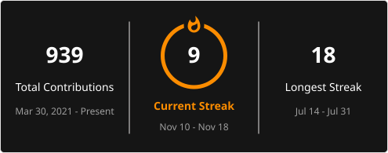

## Boo!

## _Let me tell you a bit about me:_

My name is Nikolay Kravtsov. I am `python3 -c 'import time; print((time.time() - time.mktime(time.strptime("Mon, 8 Aug 2008 00:15:00", "%a, %d %b %Y %H:%M:%S")))/(60*60*24*365))'` years old. From early childhood I loved physics, astronomy and expressed the strongest interest in programs, or rather in their root - “How do they work?”, “Why do they work?” - these were very interesting questions for me. From the age of 10 I started to learn the basics of ethical hacking - UNIX-systems, servers, basic distributions and the simplest vulnerabilities. From 12 I started learning Python, and I learned it to the level of “I can write something myself” literally in a day, and to the level of “I can solve simple tasks from interviews” in two weeks. 

So now I'm here, on [github](https://github.com/Kolya080808), telling you who I am and why I'm here (*By the way! I'm really glad I got into cybersecurity the year I should have ¯\_(ツ)_/¯  *). 

### Also something that i need to say (~no~):
#### Interesting links:

The tryhackme live updating frame:

<a href="https://tryhackme.com/r/p/Kolya080808">

And just a <a href="https://play.picoctf.org/users/n1ko123">picoCTF profile hyperlink</a> and photo:

#### GitHub stats:

## _Now about what I know:_

### Briefly languages ​​and skills in general:

Not learning c++ anymore, thought I knew it well enough, I can already write programs for Arduino and for hacking, I know C worse, but I can write a simple program, I know python3 very well. I can read Assembly.

Well, and also English, Spanish and French a bit :)

I can work with some frameworks for hackers, and I can also explain the TCP/IP model and the difference with OSI.

### What can I do in the field of information security?

I know LPE, Web, forensics at an excellent level, I know a little bit of PWN, reverse engineering a little better, I am able to solve cryptography problems at a good level.

### Where do I train and what do I use?

I use Windows 10 22h2 and WSL Kali Linux, I want to switch to Arch, but I'm too lazy to relearn and transfer data..)
I have an account on [TryHackMe](https://tryhackme.com/r/p/Kolya080808), [picoCTF](https://learn.cylabacademy.org/users/n1ko123), [HackTheBox](https://app.hackthebox.com/users/2131650). I practice most on thm, but pico also has good tasks. I solve something on HackTheBox only if there is nothing interesting on the other websites i've mentioned before.

## Some achievements so far:

### Olympiads

#### IT

- Prize-winner of the National Technology Olympiad in Information Security 24/25
- Finalist of the International Olympiad on Information Security “Innopolis Open” 25/26
- Finalist of the International Olympiad on Information Security “Innopolis Open” 24/25
- Finalist of the National Technology Olympiad in Information Security 25/26

#### Engineering

- Prize winner in the Engineering track of the Moscow Pre-Professional Olympiad for School Students, 25/26
- Finalist in the Aerospace track of the Moscow Pre-Professional Olympiad for School Students, 24/25
- Finalist of the National Technology Olympiad in satellite systems 25/26

### CTF and other achievements

#### IT

##### CTF

- Prize-winner (3rd place) of the Open online tournament of the Republic of Tatarstan on information security GO CTF 2026 26/27
- Prize winner (3rd place) of the International Tournament Narxoz CTF 2026
- Prize winner (2nd place) of Standoff Young 2026
- UgraCTF finalist, 24/25
- Finalist of the Open online tournament of the Republic of Tatarstan for information security GO CTF 2025
- Participant of the second WWCTF (47th place)

##### Research and bug bounty

- Top hacker at Rambler&Co ([link](https://bugbounty.standoff365.com/programs/portal_rambler?tab=4) - currently in 2nd place) 25/26
- I was the first to create an independent PoC for CVE-2026-97332 ([link](https://www.cve.org/CVERecord?id=CVE-2026-97332) - link in References)
- I contributed to the research and registration of several CVEs ([link](https://www.cve.org/CVERecord/SearchResults?query=kolya080808) - listed in the credits of six CVEs so far).

## ~P.S.:~

Rn I'm in the mus0r_6r0p CTF team as a captain.

If you have any questions or you think I should add something about myself, let me know in the comments [here](https://t.me/bezhopasnik/489) or in dms in Discord (username in [socials](https://infosecfamily.ru/socials/)), and I’ll add it.

[The same thing, but in channel](https://t.me/bezhopasnik/489)

[The same thing, but on website](https://infosecfamily.ru).
